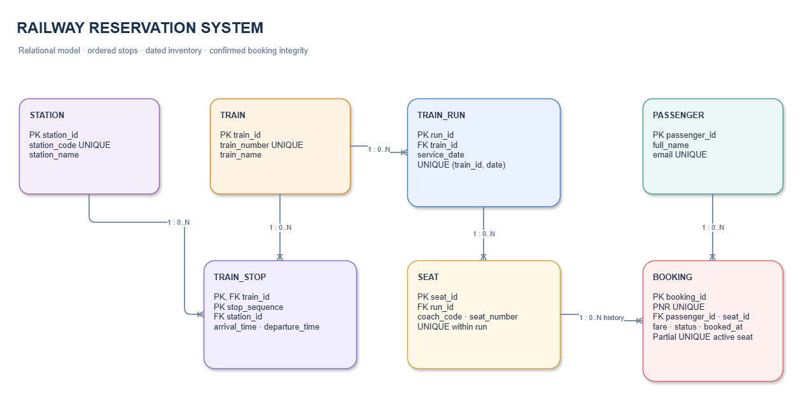

# Railway Reservation System
## Database Design Project Report

**Advanced Data Management System (DBMS) · Chandigarh University**  
**Proposed academic design · 1 November 2026**

> **Abstract.** This report proposes a relational database for a student-scale railway reservation system. It models passengers, trains, stations and stops, dated train runs, seats, and bookings. Its central goal is to make seat allocation understandable and safe when two users try to reserve the same seat. PostgreSQL is proposed for its relational constraints, transactions, and partial unique indexes. The framing, requirements, schema, and examples are design assumptions developed from the supplied topic; they are not claims of implementation or test results.

## Team and proposed responsibilities

| Member | UID | Proposed role and responsibilities |
|---|---|---|
| Abhineet | 24BCS10039 | Database requirements, passenger/train/run entities, and search query |
| Arushi Garg | 24BCS11147 | Booking and seat constraints, transaction/concurrency design, validation |
| Sumit Lakra | 24BCS10429 | Access, backup, test plan, limitations, and integration review |

Responsibilities are proposed and balanced for planning; they do not state completed implementation work. Names and IDs were supplied by the team.

## Contents

1. [Project framing](#1-project-framing)
2. [Data needs and use cases](#2-data-needs-and-use-cases)
3. [Entity relationship model](#3-entity-relationship-model)
4. [Relational schema](#4-relational-schema)
5. [Normalization and key choices](#5-normalization-and-key-choices)
6. [SQL examples](#6-sql-examples)
7. [Integrity, security, and recovery](#7-integrity-security-and-recovery)
8. [Validation, limitations, and conclusion](#8-validation-limitations-and-conclusion)
9. [References](#9-references)

## 1. Project framing

### What is proposed

The project is a database-backed reservation prototype for searching scheduled services, creating a one-passenger reservation, viewing a booking, and cancelling it. It models routes as ordered station stops and bookable services as dated train runs. A simple web or command-line interface can call application services, which issue parameterized SQL to PostgreSQL. This report focuses on the data model and database behavior rather than the interface.

### Problem, users, and objectives

A reservation workflow must connect a passenger, a particular dated journey, and a seat while retaining enough schedule information to search between stations. Duplicated files or records can show stale availability, repeat passenger details, or permit conflicting bookings. The main users are passengers and a booking clerk who maintains schedule data.

The objectives are to:

- Represent scheduled routes and dated runs without repeating passenger or train details in each booking.
- Enforce primary keys, foreign keys, valid states, non-negative fares, and unique active seat ownership.
- Demonstrate a transaction for contested seat allocation.
- Support route search and booking history with explainable joins.

### Scope and non-goals

**In scope:** one application database; train and station master records; ordered stops; dated runs; seats; one passenger and one seat per booking; confirmation, viewing, and cancellation; sample data.

**Out of scope:** railway operator integration, payments/refunds, waitlists, quotas, RAC, dynamic fares, multi-leg journeys, coach inventory imports, live platform changes, production-scale traffic, and regulatory certification. No official railway data or connection is assumed.

### Assumptions and constraints

PostgreSQL is the proposed DBMS. A train_run is one train's service on one calendar date. A seat is identified within a run by coach and seat number. Each booking represents one passenger and one seat for the full run. Cancellation preserves history and frees the seat. Clerks alone change schedule master data. Fare is stored at booking time in INR and is not recalculated. Times use the deployment's chosen local operating timezone. These are assumptions for the team and instructor to review.

### Database requirements

| ID | Requirement |
|---|---|
| D1 | Each passenger, train, station, run, seat, and booking has a stable primary key. |
| D2 | A train has ordered station stops; sequence is unique within the train. |
| D3 | A run belongs to one train/date; seat inventory belongs to one run. |
| D4 | Each booking references one passenger and one seat. |
| D5 | A seat has at most one CONFIRMED booking at a time; cancelled history remains. |
| D6 | Booking state, fare, and references satisfy database constraints. |
| D7 | Route search finds trains with both requested stations in the right order. |

## 2. Data needs and use cases

The database stores passenger name/contact, train identity, station codes/names, train-to-station order and schedule, dated runs, seat inventory, and booking history. It stores only name and email for the demonstration. A real service would need a justified retention and privacy policy and should minimize personal data.

1. **Search:** user supplies origin/destination codes; find trains with both stops and origin.stop_sequence less than destination.stop_sequence.
2. **Book:** application locks the chosen seat row, verifies no confirmed booking exists, and inserts a booking in one transaction.
3. **View:** passenger looks up a booking by PNR within authenticated account context.
4. **Cancel:** authorized passenger changes a confirmed booking to CANCELLED; the historical row remains.
5. **Maintain schedule:** clerk adds train, stops, dated run, and seats.

train_stop describes the train's route; train_run is its dated instance. The simplified schedule does not model per-run diversions or service exceptions.

## 3. Entity relationship model

The ER diagram contains seven entities. train_stop connects a train with a station and stores route order/time. A run has seat rows. Each booking references one passenger and one seat. The core active-seat invariant is enforced both by transaction flow and a database unique partial index.

*Figure 1. Entity relationship diagram, shown below as an image and an editable Mermaid block. Draw.io source: [diagrams/railway-erd.drawio](diagrams/railway-erd.drawio); Mermaid source: [diagrams/railway-erd.mmd](diagrams/railway-erd.mmd).*

~~~mermaid
erDiagram
    PASSENGER ||--o{ BOOKING : places
    TRAIN ||--o{ TRAIN_STOP : follows
    STATION ||--o{ TRAIN_STOP : appears_at
    TRAIN ||--o{ TRAIN_RUN : operates
    TRAIN_RUN ||--o{ SEAT : has
    SEAT ||--o{ BOOKING : reserved_in_history
    PASSENGER {
        bigint passenger_id PK
        varchar full_name
        varchar email UK
    }
    TRAIN {
        bigint train_id PK
        varchar train_number UK
        varchar train_name
    }
    STATION {
        bigint station_id PK
        char station_code UK
        varchar station_name
    }
    TRAIN_STOP {
        bigint train_id PK, FK
        smallint stop_sequence PK
        bigint station_id FK
        time arrival_time
        time departure_time
    }
    TRAIN_RUN {
        bigint run_id PK
        bigint train_id FK
        date service_date
    }
    SEAT {
        bigint seat_id PK
        bigint run_id FK
        varchar coach_code
        varchar seat_number
    }
    BOOKING {
        bigint booking_id PK
        varchar pnr UK
        bigint passenger_id FK
        bigint seat_id FK
        numeric fare_inr
        varchar status
        timestamptz booked_at
    }
~~~

### Booking workflow

~~~mermaid
flowchart TD
    A[Enter origin and destination] --> B[Search ordered train stops]
    B --> C[Choose dated run]
    C --> D[Select seat]
    D --> E[Begin transaction and lock seat row]
    E --> F{Confirmed booking exists?}
    F -- Yes --> G[Return seat unavailable]
    F -- No --> H[Insert CONFIRMED booking]
    H --> I[Commit and show PNR]
    I --> J[Later view or cancel booking]
    J --> K[Cancellation changes status; history remains]
~~~

The main consistency path is seat row lock → active-booking check → insert → commit. The unique partial index is a second guard if application code is faulty or another writer misses the lock protocol.

## 4. Relational schema

All tables use generated BIGINT identity primary keys unless noted. Generated keys are stable and compact; natural identifiers remain protected by unique constraints.

| Table | Purpose and columns | Keys, nullability, constraints, referential behavior |
|---|---|---|
| passenger | passenger_id BIGINT, full_name VARCHAR(120), email VARCHAR(254) | PK; all required; email unique. |
| train | train_id BIGINT, train_number VARCHAR(10), train_name VARCHAR(120) | PK; train number unique; all required. |
| station | station_id BIGINT, station_code CHAR(5), station_name VARCHAR(120) | PK; station code unique; all required. |
| train_stop | train_id BIGINT, stop_sequence SMALLINT, station_id BIGINT, arrival_time TIME, departure_time TIME | Composite PK (train_id, stop_sequence); FKs to train/station; sequence > 0; unique (train_id, station_id); endpoint times may be null. Deletes restricted while referenced. |
| train_run | run_id BIGINT, train_id BIGINT, service_date DATE | PK; train FK; unique (train_id, service_date); delete restricted while runs exist. |
| seat | seat_id BIGINT, run_id BIGINT, coach_code VARCHAR(6), seat_number VARCHAR(6) | PK; run FK; unique (run_id, coach_code, seat_number); all required; delete restricted while referenced. |
| booking | booking_id BIGINT, pnr CHAR(10), passenger_id BIGINT, seat_id BIGINT, fare_inr NUMERIC(9,2), status VARCHAR(12), booked_at TIMESTAMPTZ | PK; unique PNR; passenger/seat FKs; fare >= 0; status in CONFIRMED/CANCELLED; all required; deletes restricted to preserve history. |

A partial unique index on confirmed booking seat_id enforces current ownership while allowing cancelled rows. A passenger/time index supports booking history. DDL follows.

## 5. Normalization and key choices

The schema aims for Third Normal Form (3NF) for the attributes shown:

- In passenger, name and email describe passenger_id; email is separately a candidate key.
- In train and station, names depend on their own IDs and are not copied into train_stop, train_run, or booking.
- In train_stop, station and schedule attributes depend on the composite key (train_id, stop_sequence). Station name remains in station; route order belongs to this train-stop association.
- In train_run, service date is unique for a train. Train name/number remain in train.
- In seat, coach and seat number are unique within a run.
- In booking, passenger, seat, fare snapshot, state, PNR, and timestamp depend on booking_id. Fare is a historical quote, not a passenger or seat property.

Generated keys are stable internal references; business identifiers such as station code and PNR are unique but not foreign keys. The composite key is retained for train_stop, where sequence matters only inside one train. These choices reduce duplication and update anomalies.

## 6. SQL examples

The following representative DDL targets PostgreSQL 16 or later. It is design material, not an execution log.

### DDL and indexes

~~~sql
CREATE TABLE passenger (
  passenger_id BIGINT GENERATED ALWAYS AS IDENTITY PRIMARY KEY,
  full_name VARCHAR(120) NOT NULL,
  email VARCHAR(254) NOT NULL UNIQUE
);
CREATE TABLE train (
  train_id BIGINT GENERATED ALWAYS AS IDENTITY PRIMARY KEY,
  train_number VARCHAR(10) NOT NULL UNIQUE,
  train_name VARCHAR(120) NOT NULL
);
CREATE TABLE station (
  station_id BIGINT GENERATED ALWAYS AS IDENTITY PRIMARY KEY,
  station_code CHAR(5) NOT NULL UNIQUE,
  station_name VARCHAR(120) NOT NULL
);
CREATE TABLE train_stop (
  train_id BIGINT NOT NULL REFERENCES train(train_id) ON DELETE RESTRICT,
  stop_sequence SMALLINT NOT NULL CHECK (stop_sequence > 0),
  station_id BIGINT NOT NULL REFERENCES station(station_id) ON DELETE RESTRICT,
  arrival_time TIME,
  departure_time TIME,
  PRIMARY KEY (train_id, stop_sequence),
  UNIQUE (train_id, station_id)
);
CREATE TABLE train_run (
  run_id BIGINT GENERATED ALWAYS AS IDENTITY PRIMARY KEY,
  train_id BIGINT NOT NULL REFERENCES train(train_id) ON DELETE RESTRICT,
  service_date DATE NOT NULL,
  UNIQUE (train_id, service_date)
);
CREATE TABLE seat (
  seat_id BIGINT GENERATED ALWAYS AS IDENTITY PRIMARY KEY,
  run_id BIGINT NOT NULL REFERENCES train_run(run_id) ON DELETE RESTRICT,
  coach_code VARCHAR(6) NOT NULL,
  seat_number VARCHAR(6) NOT NULL,
  UNIQUE (run_id, coach_code, seat_number)
);
CREATE TABLE booking (
  booking_id BIGINT GENERATED ALWAYS AS IDENTITY PRIMARY KEY,
  pnr CHAR(10) NOT NULL UNIQUE,
  passenger_id BIGINT NOT NULL REFERENCES passenger(passenger_id) ON DELETE RESTRICT,
  seat_id BIGINT NOT NULL REFERENCES seat(seat_id) ON DELETE RESTRICT,
  fare_inr NUMERIC(9,2) NOT NULL CHECK (fare_inr >= 0),
  status VARCHAR(12) NOT NULL CHECK (status IN ('CONFIRMED','CANCELLED')),
  booked_at TIMESTAMPTZ NOT NULL DEFAULT CURRENT_TIMESTAMP
);
CREATE UNIQUE INDEX one_confirmed_booking_per_seat
  ON booking(seat_id) WHERE status = 'CONFIRMED';
CREATE INDEX booking_by_passenger_time
  ON booking(passenger_id, booked_at DESC);
CREATE INDEX train_stop_by_station
  ON train_stop(station_id, train_id, stop_sequence);
~~~

The partial unique index is the database invariant for a current seat owner. The two lookup indexes match stated history/search queries; indexes consume space and make writes more expensive, so they should be purposeful.

### Insert, update, and ordered route query

~~~sql
INSERT INTO passenger(full_name, email)
VALUES ('Aarav Sharma', 'aarav@example.edu');
INSERT INTO train(train_number, train_name)
VALUES ('12951', 'Demo Express');
UPDATE train
SET train_name = 'Demo Express (Updated)'
WHERE train_number = '12951';

SELECT t.train_number, t.train_name,
       origin.station_id AS origin_id,
       destination.station_id AS destination_id
FROM train t
JOIN train_stop origin ON origin.train_id = t.train_id
JOIN train_stop destination ON destination.train_id = t.train_id
WHERE origin.station_id = 10
  AND destination.station_id = 22
  AND origin.stop_sequence < destination.stop_sequence;
~~~

The query finds a train with both stations in the requested order. A real search would also filter dated runs and selected service date.

### One-seat booking transaction

~~~sql
BEGIN;
-- Parameters are supplied by the application.
SELECT seat_id FROM seat WHERE seat_id = :seat_id FOR UPDATE;
INSERT INTO booking (pnr, passenger_id, seat_id, fare_inr, status)
SELECT :pnr, :passenger_id, s.seat_id, :fare_inr, 'CONFIRMED'
FROM seat s
WHERE s.seat_id = :seat_id
  AND NOT EXISTS (
    SELECT 1 FROM booking b
    WHERE b.seat_id = s.seat_id AND b.status = 'CONFIRMED'
  )
RETURNING booking_id, pnr, status;
COMMIT;
~~~

The application checks that the lock found a seat, handles no returned row or unique-index conflict as unavailable, and rolls back on errors. A cancellation transaction updates CONFIRMED to CANCELLED, preserving history and allowing a later booking.

### Aggregate example

~~~sql
SELECT t.train_number, COUNT(*) AS confirmed_bookings
FROM booking b
JOIN seat se ON se.seat_id = b.seat_id
JOIN train_run r ON r.run_id = se.run_id
JOIN train t ON t.train_id = r.train_id
WHERE b.status = 'CONFIRMED'
  AND r.service_date = DATE '2026-12-01'
GROUP BY t.train_number
ORDER BY confirmed_bookings DESC;
~~~

This counts confirmed bookings by train and date; it does not claim passenger boarding statistics.

## 7. Integrity, security, and recovery

**Validation.** NOT NULL protects required values; CHECK limits state and fare; UNIQUE protects business identifiers; foreign keys prevent orphan references. Route order is checked in the search query. Cross-row schedule checks need application logic or a richer timestamp model; a simple row-level check cannot compare arbitrary stop rows.

**Access.** The application should use a least-privilege database role. A passenger should only view or cancel their own eligible booking through an authenticated service; schedule editing belongs to a clerk role. Use parameterized SQL. Passwords belong in an authentication provider, not these tables. Logs should avoid emails, credentials, and unnecessary booking details. These controls are planned, not implemented claims.

**Concurrency and failure.** Lock the chosen seat before checking active booking state, then insert and commit. The partial unique index remains a final guard. On conflict or database outage, roll back and show a retryable error without claiming a reservation. Cancellation changes status rather than deleting a row.

**Backup and retention.** For a class prototype, schedule logical backups (for example, pg_dump) to a protected location and practice restoring into a separate database. Production requires tested restore procedures, protected off-site retention, measured recovery objectives, encryption, and access controls. No backup or restore has been performed for this proposed design. Retain cancelled history only according to an agreed project policy; use synthetic passenger records for demonstrations.

## 8. Validation, limitations, and conclusion

A practical test plan would check: invalid foreign keys; duplicate PNR, station code, email, or seat inventory; negative fare and invalid status; route order in both directions; successful booking; concurrent requests for one seat with only one confirmed result; cancellation then rebooking; and backup restore. These are planned cases, not test outcomes. If implementation follows, record DB version, commands, and actual results.

The design omits payments, refunds, multi-passenger bookings, quotas, waitlists, live operator feeds, and journey-segment reuse. Reserving a seat for an entire run is simple and safe but may waste capacity when passengers travel on non-overlapping segments. Static stops do not include exceptions. A real system requires operational and privacy review before deployment.

The model separates passenger, schedule, dated inventory, and booking history. Its central choice is a row lock plus conditional insert and a unique partial index for active-seat ownership. This provides a focused foundation for implementation and testing without implying that the work has already been built.

## 9. References

1. PostgreSQL, [Constraints](https://www.postgresql.org/docs/current/ddl-constraints.html).
2. PostgreSQL, [Indexes](https://www.postgresql.org/docs/current/indexes.html).
3. PostgreSQL, [Transaction Isolation](https://www.postgresql.org/docs/current/transaction-iso.html).
4. PostgreSQL, [Explicit Locking](https://www.postgresql.org/docs/current/explicit-locking.html).
5. OWASP, [Database Security Cheat Sheet](https://cheatsheetseries.owasp.org/cheatsheets/Database_Security_Cheat_Sheet.html).

