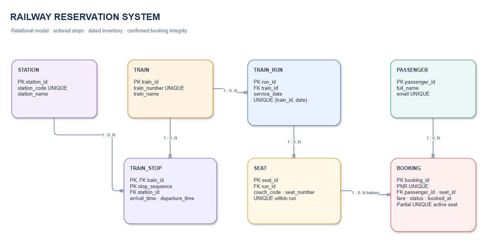

# Railway Reservation System

A student scale database project for managing railway schedules, reservations, passengers, and ticket records.

## Project report

Read [DBMS_Project_Report.md](DBMS_Project_Report.md) for the problem definition, requirements, relational model, schema, sample SQL, and design decisions.

## Repository contents

- `assets/` — report cover and rendered database diagram
- `diagrams/` — editable Draw.io source and Mermaid diagram sources
- `DBMS_Project_Report.md` — main academic report
